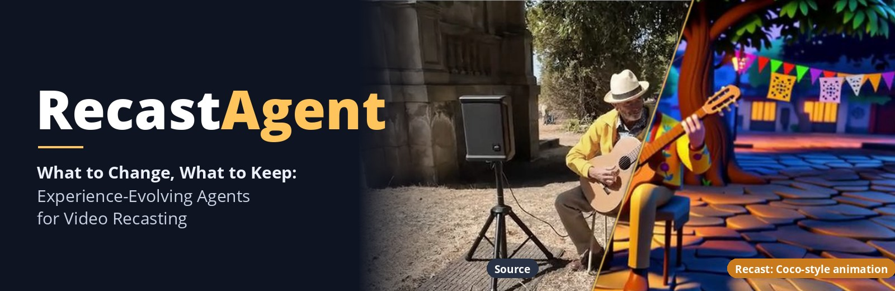
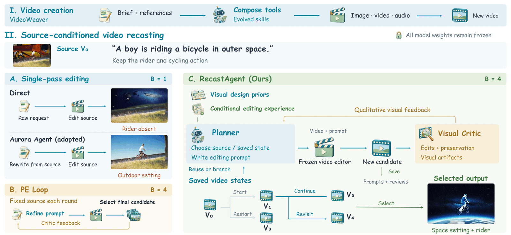
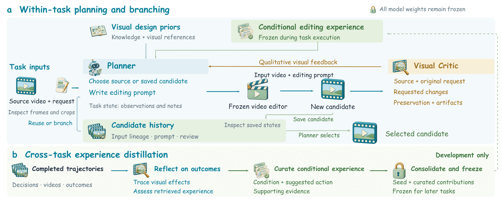
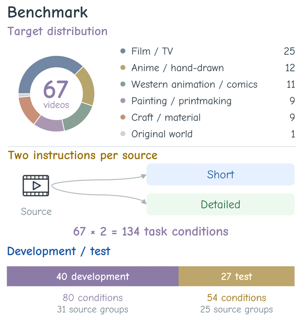
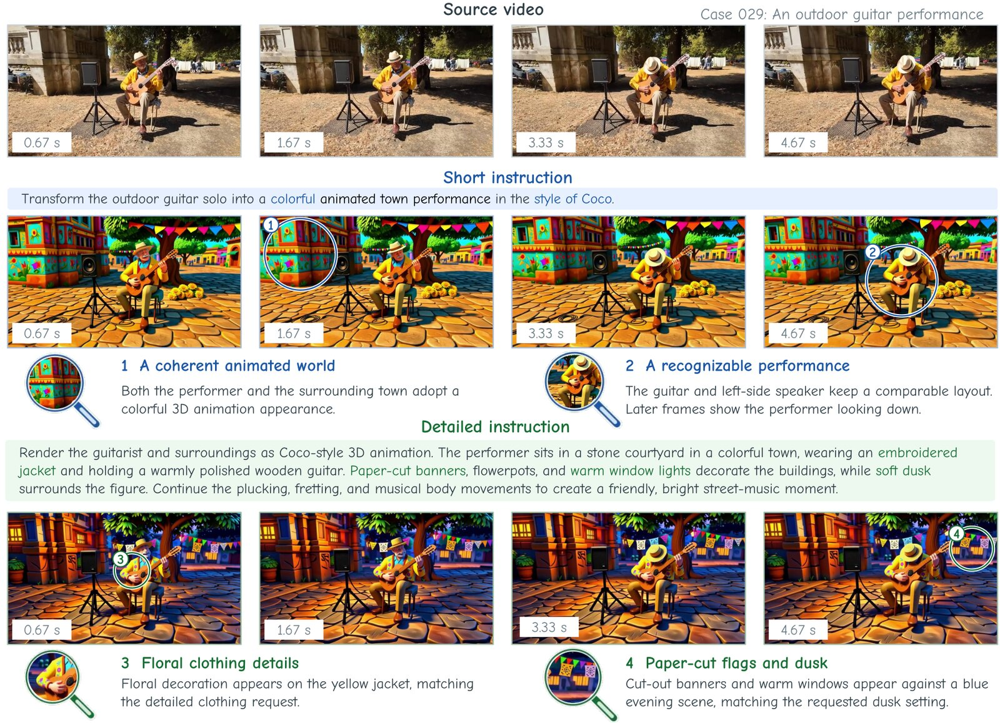
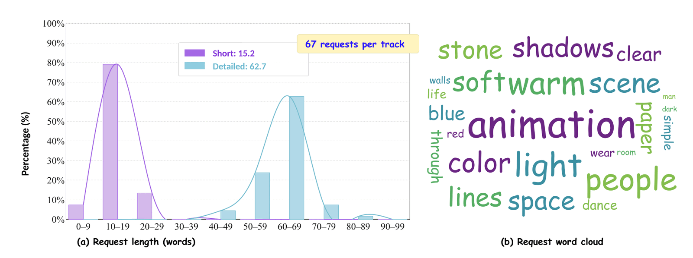
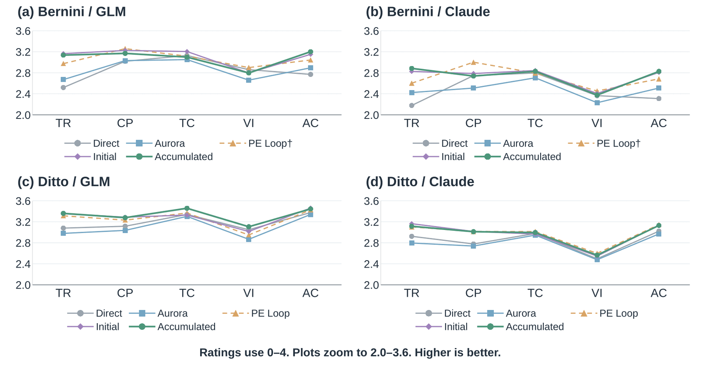

<p align="center">
  
</p>

<p align="center">
  
  
  
  
</p>

<p align="center">
  <a href="#method">Method</a> ·
  <a href="#benchmark">Benchmark</a> ·
  <a href="#results">Results</a> ·
  <a href="#quick-start-cpu-only-no-credentials">Quick start</a> ·
  <a href="#running-the-experiments">Experiments</a> ·
  <a href="#citation">Citation</a>
</p>

## Overview

<p align="center">
  
</p>

*Video recasting* moves the entities and environment of an existing video into a new
visual world, such as a hand-drawn cartoon, a film universe or a craft material, while
keeping its essential actions, interactions and spatial relations. It changes the
world in which an event happens, not the event itself.

**RecastAgent** is a training-free agentic framework for this task:

- 🧭 **Experience-Guided Planner**: chooses both the editing prompt and the *input video
  state* at each step, either the source or any saved candidate, so it can build on
  partial progress or backtrack.
- 🔍 **Visual Critic**: reviews every result against the original request and gives
  qualitative feedback, not a score.
- 📚 **Experience Accumulation**: turns completed trajectories into conditional,
  evidence-linked advice for later tasks.

All model weights stay frozen.

## Method

<p align="center">
  
</p>

**(a) Within-task planning and branching.** The Planner grounds the request in the
source video. It inspects native frames and crops, then reads visual design priors and
the frozen experience library. At each attempt it picks an input (the source, or a
saved candidate to continue from or return to) and writes a prompt for the frozen
editor. The independent Visual Critic compares the source, request, input, prompt and
new candidate. It returns qualitative feedback on requested changes, preserved
relations and artifacts, and gives no score. After the generation budget (B = 4)
is used, the Planner delivers any saved candidate. That candidate does not have to be
the latest one.

**(b) Cross-task experience distillation.** After each *development* task,
maintenance traces the visual effects of each decision and checks whether retrieved
advice applied. It then curates conditional contributions (condition, suggested
action, supporting evidence). All development tasks read the same initial library
E<sub>0</sub>. Their contributions are consolidated into E<sub>1</sub>, which is frozen
before held-out testing.

| Planner tool | Function |
|---|---|
| `observe` | Overview, consecutive native frames, or crops of one or more videos |
| `browse`, `search`, `read` | Navigate and read design references and experience entries |
| `view_reference` | View a reference image |
| `video`, `history` | Exact prompt and provenance of a video; earlier reviews |
| `note` | Keep working notes |
| `generate` | Edit a chosen input video with a prompt |
| `finish` | Deliver a chosen candidate |

The knowledge shipped here includes 111 style entries (98 OPUSCAR cases with
reference stills and 13 world templates), 7 design guides and 5 domain references. It
also includes the initial experience library: 21 entries in three layers (general
principles, editor behavior, task conditions) backed by 74 evidence resources.

## Benchmark

<table>
<tr>
<td width="34%"></td>
<td>

67 source videos across six target categories. Each source has a **short** request
that leaves design open and a **detailed** request that specifies setting, attire,
materials, lighting or interactions, giving **134 conditions**. Related clips form 56
source groups, split into 40 development sources (31 groups, 80 conditions) and 27
held-out test sources (25 groups, 54 conditions).

The manifest, English and Chinese prompts and SHA-256 hashes are in
[`benchmark_data/`](benchmark_data/README.md). Source videos are distributed
separately.

</td>
</tr>
</table>

<p align="center">
  
</p>
<p align="center"><em>Paired specifications for source 029 (Coco-style performance).</em></p>

<p align="center">
  
</p>

**Evaluation.** GLM-5.3-Flash and Claude-Sonnet-5.5 judge anonymized outputs
independently, using frame plans derived from the source. Each output gets:

- **Instruction diagnostics:** request completion, required source correspondence and
  unrequested damage. Detailed requests add binding and joint satisfaction; short
  requests add style realization and creativity.
- **Five-axis quality** (0–4): Target Realization (TR), Content Correspondence (CP),
  Temporal Consistency (TC), Visual Integrity (VI) and Aesthetic Coordination (AC).
- **Blind pairwise task completion:** each pair is judged in both orders, and only
  order-consistent outcomes count.

See [docs/low-high-evaluation-v2.md](docs/low-high-evaluation-v2.md).

## Results

Editors: Bernini and Ditto, frozen. Online Planner, Critic, PE prompt enhancement and
reflection all use GPT-6-Luna (high reasoning effort). Multi-round methods use B = 4
with seeds 42–45. *Initial* and *Accumulated* denote the Planner with E<sub>0</sub>
and E<sub>1</sub>.

**Blind pairwise task completion** (win / tie / loss %, first method vs. second;
*n* = order-consistent pairs; *test* = held-out conditions)

| Judge | Editor | Comparison | Win | Tie | Loss | *n* |
|---|---|---|---:|---:|---:|---:|
| GLM | Bernini | Initial vs. Aurora (all) | **84.6** | 0.0 | 15.4 | 104 |
| GLM | Bernini | Accumulated vs. Aurora (test) | **83.7** | 0.0 | 16.3 | 43 |
| GLM | Ditto | Initial vs. Aurora (all) | **89.6** | 1.3 | 9.1 | 77 |
| GLM | Ditto | Accumulated vs. Aurora (test) | **85.7** | 0.0 | 14.3 | 21 |
| Claude | Bernini | Initial vs. Aurora (all) | **79.8** | 0.0 | 20.2 | 114 |
| Claude | Bernini | Accumulated vs. Aurora (test) | **84.8** | 0.0 | 15.2 | 46 |
| Claude | Ditto | Initial vs. Aurora (all) | **83.5** | 0.0 | 16.5 | 109 |
| Claude | Ditto | Accumulated vs. Aurora (test) | **85.4** | 0.0 | 14.6 | 41 |
| GLM | Ditto | Initial vs. PE Loop (all) | 37.3 | 10.2 | **52.5** | 59 |
| GLM | Ditto | Accumulated vs. PE Loop (test) | 34.6 | 11.5 | **53.8** | 26 |
| Claude | Ditto | Initial vs. PE Loop (all) | 48.2 | 0.0 | **51.8** | 85 |
| Claude | Ditto | Accumulated vs. PE Loop (test) | 42.3 | 0.0 | **57.7** | 26 |
| GLM | Bernini | Initial: final vs. first attempt (all) | **56.7** | 22.2 | 21.1 | 90 |
| Claude | Bernini | Initial: final vs. first attempt (all) | **63.5** | 17.3 | 19.2 | 104 |
| GLM | Ditto | Accumulated: final vs. first attempt (all) | **61.4** | 27.1 | 11.4 | 70 |
| Claude | Ditto | Accumulated: final vs. first attempt (all) | **57.0** | 22.6 | 20.4 | 93 |

**Five-axis quality** (0–4, source-macro-averaged over all 134 conditions)

<p align="center">
  
</p>

| Editor | Method | GLM TR | GLM AC | Claude TR | Claude AC |
|---|---|---:|---:|---:|---:|
| Bernini | Direct | 2.520 | 2.770 | 2.178 | 2.309 |
| Bernini | Aurora Agent | 2.671 | 2.895 | 2.425 | 2.510 |
| Bernini | PE Loop† | 2.975 | 3.044 | 2.602 | 2.685 |
| Bernini | **RecastAgent (initial)** | **3.165** | 3.152 | 2.827 | 2.808 |
| Bernini | **RecastAgent (accumulated)** | 3.137 | **3.202** | **2.884** | **2.827** |
| Ditto | Direct | 3.080 | 3.376 | 2.924 | 3.022 |
| Ditto | Aurora Agent | 2.980 | 3.340 | 2.796 | 2.969 |
| Ditto | PE Loop | 3.314 | 3.427 | 3.103 | **3.145** |
| Ditto | **RecastAgent (initial)** | 3.354 | **3.462** | **3.164** | 3.133 |
| Ditto | **RecastAgent (accumulated)** | **3.360** | 3.445 | 3.115 | 3.131 |

† Bernini PE Loop uses a mixed evaluation cohort.

**Zero-shot transfer** with Bernini on stratified 36-case subsets of FiVE-Bench and
VE-Bench. The accumulated library is reused without benchmark-specific updates.

| Method | FiVE PSNR ↑ | FiVE CLIP-T ↑ | FiVE-Acc ↑ | VE QA ↑ | VE Win % ↑ |
|---|---:|---:|---:|---:|---:|
| Direct | 24.61 | 26.95 | 22.1 | 0.067 | – |
| Aurora Agent | **25.80** | 27.27 | 18.6 | 0.037 | 42.9 |
| RecastAgent (accumulated) | 25.51 | **27.68** | **26.4** | **0.199** | **57.1** |

On Ditto, PE Loop wins slightly more pairwise comparisons than the Planner, although
their five-axis scores are close. Over 50% of completed runs deliver an earlier
candidate rather than the last one. On
held-out conditions, GLM prefers the accumulated library over the initial one (60–67%
win rate), while Claude rates the two near parity.

## Quick start (CPU only, no credentials)

Requires Python 3.11+ and `ffmpeg`/`ffprobe` on `PATH`.

```bash
python3 -m venv .venv && source .venv/bin/activate
python -m pip install -r requirements.server-runtime.txt

# Print the task matrix of the main experiment; submits nothing
python scripts/run_experiment_campaign.py plan --backend both

# End-to-end smoke run with synthetic videos and scripted model responses
python scripts/smoke_experiment_campaign.py --output out/public-smoke

# Offline regression suite
python scripts/check_repository.py --suite current
```

The smoke run blocks network access and GPU libraries. It checks software behavior,
not model quality.

## Running the experiments

1. Put the benchmark videos at the paths listed in `benchmark_data/benchmark.json`.
2. Install a renderer (Bernini-R or Ditto) and its weights, then pin them with
   `scripts/deploy/pin_bernini_runtime.py` or `scripts/deploy/download_ditto_models.py`.
3. Copy `configs/*-campaign-host.example.json` to `*.local.json` and fill in devices and
   asset paths. Keep API keys outside the repository, e.g. in
   `~/.config/recast/openrouter.env` (`OPENROUTER_API_KEY`, `OPENROUTER_BASE_URL`).
4. Validate offline, then run:

```bash
python scripts/run_experiment_campaign.py check --backend bernini \
  --host-config configs/bernini-campaign-host.local.json --verify-assets
python scripts/run_experiment_campaign.py run --backend bernini --stage main \
  --host-config configs/bernini-campaign-host.local.json \
  --output out/formal/bernini --execute
python scripts/benchmark_results.py score-evaluation \
  --root out/formal/bernini/results --execute
```

The `main` stage runs four steps in order:

1. The Planner with E<sub>0</sub>, collecting development contributions.
2. The Planner with the frozen E<sub>1</sub>.
3. Direct editing.
4. The PE Loop baseline.

Independent scoring follows. Use `--devices 0 1 2 3` to spread tasks across GPUs on
one host. The complete procedure is in
[docs/public-experiment-guide.md](docs/public-experiment-guide.md). The Aurora Agent
baseline and the FiVE-Bench / VE-Bench runs used their official releases and are
not part of this repository.

## Repository layout

| Path | Contents |
|---|---|
| `src/planner_harness/` | Task state, Planner tools, working memory, delivery, accounting, recovery, experience maintenance |
| `src/critic_harness/` | Online Visual Critic and shared video-evidence tools |
| `src/experiments/` | Campaign orchestration, methods (Planner, Direct, PE Loop), multi-GPU scheduling, result registry |
| `src/evaluation/` | Independent judges, automatic metrics, pairwise comparison and statistics |
| `src/server_runtime/` | Persistent job queue and resident Bernini/Ditto renderers |
| `src/vlm/` | Model API clients and role settings |
| `knowledge/` | Design references, guides and the curated experience library |
| `opuscar/` | OPUSCAR 98 source records and reference stills used by the style entries |
| `configs/` | Task, host, campaign and judge configuration |
| `scripts/` | Command-line entry points and offline tests |
| `docs/` | Experiment, runtime, evaluation and experience documentation |
| `third_party/Bernini/` | Bernini renderer code (Apache-2.0) |

## Third-party material

`third_party/Bernini` keeps its own license. The OPUSCAR 98 records and stills in
`opuscar/` are attributed to their original source in [opuscar/README.md](opuscar/README.md).
Model weights and benchmark videos are not distributed here.

## Citation

```bibtex
@misc{recastagent,
  title  = {What to Change, What to Keep: Experience-Evolving Agents for Video Recasting},
  author = {Anonymous},
  year   = {2026}
}
```
